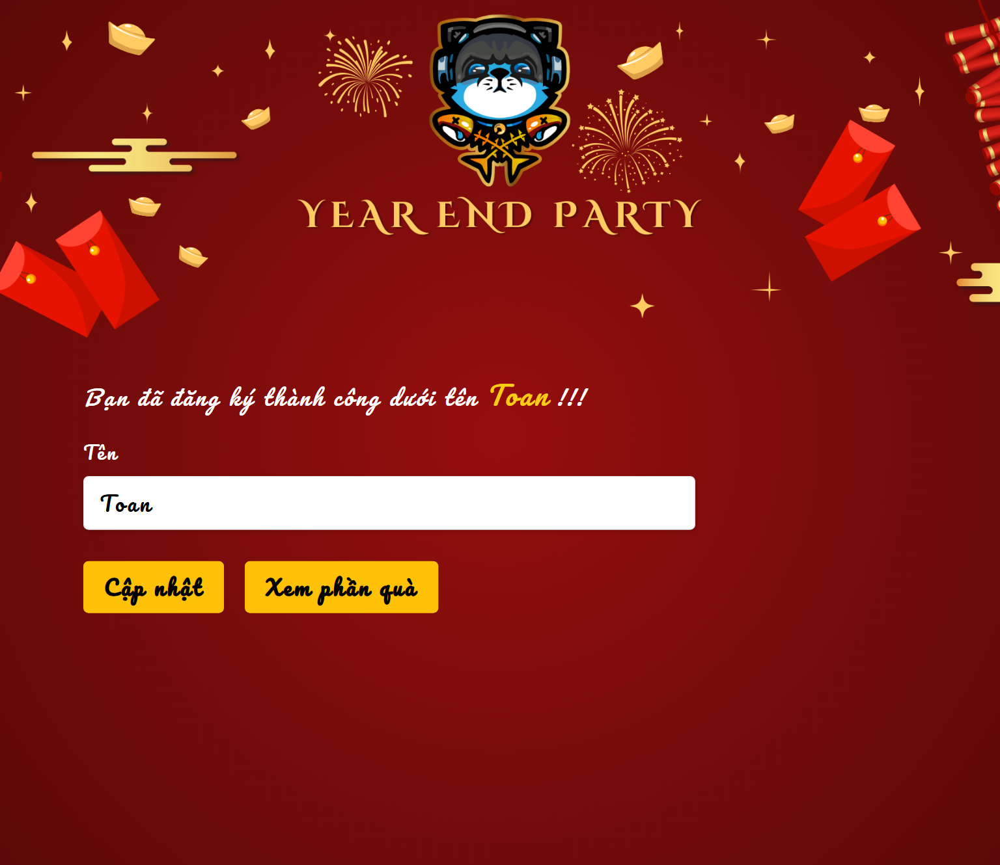
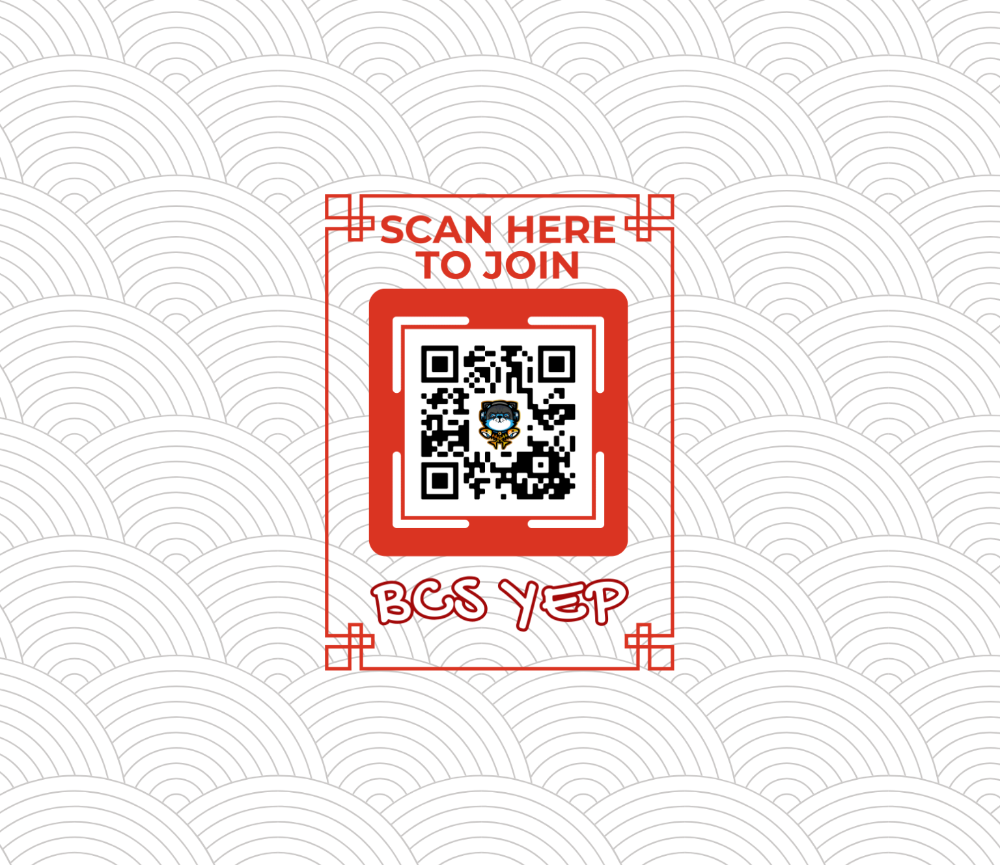

# BCS Year End Party · Vòng Quay Quà Tặng Sự Kiện 🎉

> **Ứng dụng web tương tác thời gian thực phục vụ sự kiện Tiệc Tất Niên (Year End Party). Tự động hóa toàn bộ quy trình ghi danh khách mời qua mã QR, quay số phân phát ngẫu nhiên 40 phần quà đặc biệt và đồng bộ trực tiếp lên màn hình chiếu lớn (Live Projector Screen) với độ trễ gần như bằng 0 nhờ công nghệ Cloud Firestore Realtime Sync.**

  <h3>🚀 Trải nghiệm BCS Year End Party trực tiếp</h3>
  
Khám phá bảng quà tặng sự kiện thời gian thực và trải nghiệm ghi danh trực tuyến.

  
  
<a href="https://nhttoan0809.github.io/BCS-YEP-2024/"><strong>nhttoan0809.github.io/BCS-YEP-2024 ↗</strong></a>

**Dự án của Toàn Nguyễn** · Phát triển ứng dụng web sự kiện thời gian thực (Realtime Event Web App)

[Xem tính năng](#features) · [Tài liệu kỹ thuật & cài đặt](TECHNICAL.md)

_Ảnh chụp giao diện màn hình chính của sự kiện trên GitHub Pages. 40 phần quà hiển thị tên khách mời tương ứng ngay khi ghi danh thành công qua Firestore listener._

---

## 🌟 Trải Nghiệm Trực Tuyến (Live Website)

- **Màn hình chính sự kiện (Stage Display):** [https://nhttoan0809.github.io/BCS-YEP-2024/](https://nhttoan0809.github.io/BCS-YEP-2024/)
- **Cổng ghi danh di động (Mobile Check-in):** [https://nhttoan0809.github.io/BCS-YEP-2024/form](https://nhttoan0809.github.io/BCS-YEP-2024/form)
- **Mã QR check-in sự kiện (QR Code Page):** [https://nhttoan0809.github.io/BCS-YEP-2024/qr-code](https://nhttoan0809.github.io/BCS-YEP-2024/qr-code)

---

## 📌 Executive Summary (Tổng quan dự án)

| Thông số               | Chi tiết                                                                                                                                           |
| :--------------------- | :------------------------------------------------------------------------------------------------------------------------------------------------- |
| **Project Name**       | **BCS Year End Party Gift Randomizer** (`BCS-YEP-2024`)                                                                                            |
| **Project Type**       | Ứng dụng web tương tác thời gian thực cho sự kiện (Realtime Event Web App)                                                                         |
| **Đối tượng sử dụng**  | Ban tổ chức sự kiện và toàn thể thành viên / khách mời tham dự tiệc tất niên BCS                                                                   |
| **Phạm vi phát triển** | Check-in qua QR code trên di động, thuật toán phân quà ngẫu nhiên công bằng và bảng màn hình sân khấu đồng bộ tức thì qua Cloud Firestore listener |
| **Trạng thái**         | Hoàn thiện bản mẫu phục vụ sự kiện thực tế, đồng bộ realtime 40 phần quà; tự động deploy qua GitHub Pages                                          |

---

## 🎯 Problem & Solution (Bài toán & Giải pháp)

- **Problem:** Tại các buổi tiệc cuối năm, khâu bốc thăm chia quà thủ công thường tốn nhiều thời gian chuẩn bị vé số, dễ gây ùn tắc tại quầy lễ tân check-in, thiếu tính minh bạch và khó tạo được không khí sôi nổi đồng loạt cho khán phòng đông người.
- **Solution:** Xây dựng ứng dụng web phân tán với màn hình trình chiếu sân khấu (Stage Display) kết hợp cổng ghi danh di động (Mobile Check-in qua mã QR). Khi khách mời nhập tên trên điện thoại cá nhân, hệ thống tự động gán ngẫu nhiên một phần quà chưa mở và cập nhật tức thì lên màn hình LED hội trường thông qua Firestore Snapshot Listener mà không cần tải lại trang.

---

## ✨ Key Features (Tính năng nổi bật)

| Tính năng                            | Giá trị mang lại                                                                                                 |
| :----------------------------------- | :--------------------------------------------------------------------------------------------------------------- |
| **Ghi danh di động siêu tốc (QR)**   | Khách quét mã QR trên bàn tiệc để tự check-in trong vài giây, giảm thiểu hoàn toàn ùn tắc tại cửa ra vào         |
| **Phân quà ngẫu nhiên công bằng**    | Thuật toán tự động ghép đôi tên người tham dự với các phần quà bí mật chưa mở, tạo sự hồi hộp và bất ngờ thú vị |
| **Màn hình sân khấu Realtime**       | Bảng danh sách tích hợp live animation cập nhật tức thì tên người nhận và hình ảnh quà tặng ngay khi có lượt gửi |
| **Cơ chế chống trùng lặp & đổi tên** | Hỗ trợ người tham dự chỉnh sửa lại tên nếu nhập sai trong phiên tạm mà không làm xáo trộn kết quả của người khác |

<strong>Xem thêm: biểu mẫu ghi danh và trang QR sự kiện</strong>

---

## 👨‍💻 Competencies & Contributions (Năng lực & Đóng góp)

- **Hiểu bối cảnh sử dụng thực tế:** Tập trung vào những thao tác cần thiết trong một buổi tiệc có thời gian chuẩn bị ngắn, tối ưu hóa tốc độ tải và khả năng đáp ứng trên mạng di động.
- **Thiết kế trải nghiệm trọn vẹn:** Kết nối khâu ghi danh trên điện thoại, gán quà ngẫu nhiên và trình chiếu sân khấu thành một hành trình tương tác liền mạch, trực quan.
- **Lập trình thời gian thực (Realtime Web):** Ứng dụng Firebase Firestore Snapshot Listener để đồng bộ dữ liệu hai chiều không độ trễ giữa thiết bị khách mời và màn hình chiếu lớn.
- **Tối ưu triển khai tự động CI/CD:** Cấu hình pipeline GitHub Actions tự động build ứng dụng React, xử lý fallback SPA routing cho GitHub Pages.

---

## 📈 Future Roadmap (Hướng phát triển)

- [ ] Quản lý tồn kho quà bằng transaction atomic chặt chẽ hơn khi có lượng lớn người truy cập cùng lúc.
- [ ] Bổ sung hiệu ứng âm thanh và pháo hoa chúc mừng trên màn hình chiếu khi mở quà đặc biệt.
- [ ] Nâng cấp nền tảng lên React mới và chuyển đổi cấu hình Firebase sang biến môi trường (`.env`).

---

## 👤 Author & Contact

- **Tác giả:** Toàn Nguyễn
- **GitHub:** [@nhttoan0809](https://github.com/nhttoan0809)
- **Tài khoản sinh viên (cùng tác giả):** [@toanb1805926](https://github.com/toanb1805926)

---

## 📄 License

Xem [thông tin giấy phép và tài nguyên bên thứ ba](TECHNICAL.md#license).
