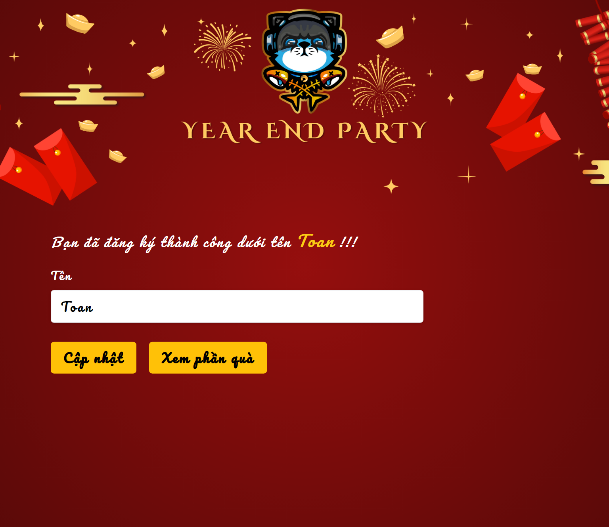
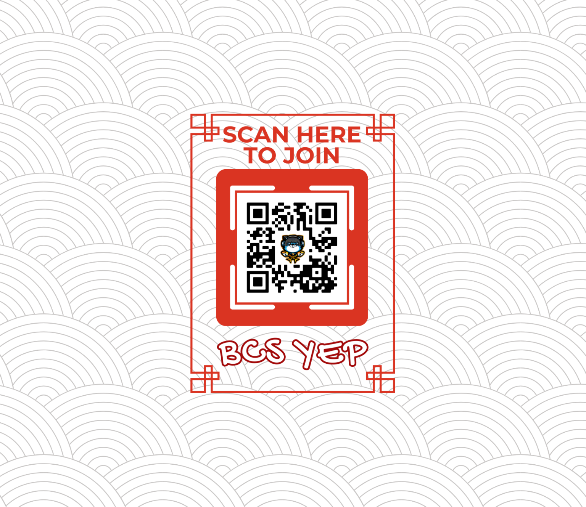

# BCS Year End Party — Vòng Quay Quà Tặng Sự Kiện 🎉

> **Ứng dụng web tương tác thời gian thực phục vụ sự kiện Tiệc Tất Niên (Year End Party). Tự động hóa toàn bộ quy trình ghi danh khách mời qua mã QR, quay số phân phát ngẫu nhiên 40 phần quà đặc biệt và đồng bộ trực tiếp lên màn hình chiếu lớn (Live Projector Screen) với độ trễ gần như bằng 0 nhờ công nghệ Cloud Firestore Realtime Sync.**

**Dự án của Toàn Nguyễn** · Ứng dụng web sự kiện thời gian thực (Realtime Event App)

[Xem tính năng](#features) · [Tài liệu kỹ thuật & cài đặt](TECHNICAL.md)

---

## 📌 Executive Summary (Tổng quan dự án)

| Thông số               | Chi tiết                                                                       |
| :--------------------- | :----------------------------------------------------------------------------- |
| **Project Name**       | **BCS Year End Party Gift Randomizer**                                         |
| **Project Type**       | Ứng dụng web tương tác thời gian thực cho sự kiện (Realtime Event Web App)     |
| **Đối tượng sử dụng**  | Ban tổ chức sự kiện và toàn thể thành viên/khách mời tham dự tiệc cuối năm BCS |
| **Phạm vi phát triển** | Check-in qua QR code, thuật toán phân quà ngẫu nhiên và bảng hiển thị trực tiếp |
| **Trạng thái**         | Bản mẫu phục vụ sự kiện thực tế, đồng bộ realtime cho 40 phần quà              |

---

## 🎯 Problem & Solution (Bài toán & Giải pháp)

- **Problem:** Tại các buổi tiệc cuối năm, khâu bốc thăm chia quà thủ công thường tốn nhiều thời gian chuẩn bị, dễ gây ùn tắc tại quầy check-in, thiếu tính minh bạch và khó tạo được không khí sôi nổi đồng loạt cho khán phòng đông người.
- **Solution:** Xây dựng ứng dụng web phân tán với màn hình trình chiếu sân khấu (Stage Display) kết hợp cổng ghi danh di động (Mobile Check-in qua QR code). Khi khách mời nhập tên trên điện thoại cá nhân, hệ thống tự động gán ngẫu nhiên một phần quà chưa mở và cập nhật tức thì lên màn hình LED hội trường thông qua Firestore Snapshot Listener mà không cần tải lại trang.

---

## ✨ Key Features (Tính năng nổi bật)

| Tính năng                           | Giá trị mang lại                                                                                                 |
| :---------------------------------- | :--------------------------------------------------------------------------------------------------------------- |
| **Ghi danh di động siêu tốc (QR)**  | Khách quét mã QR trên bàn tiệc để tự check-in trong vài giây, giảm thiểu hoàn toàn ùn tắc tại cửa ra vào         |
| **Phân quà ngẫu nhiên công bằng**   | Thuật toán tự động ghép đôi tên người tham dự với các phần quà bí mật chưa mở, tạo sự hồi hộp và bất ngờ thú vị |
| **Màn hình sân khấu Realtime**      | Bảng danh tích hợp live animation cập nhật tức thì tên người nhận và hình ảnh quà tặng ngay khi có lượt gửi mới   |
| **Cơ chế chống trùng lặp & đổi tên**| Hỗ trợ người tham dự chỉnh sửa lại tên nếu nhập sai trong phiên tạm mà không làm xáo trộn kết quả của người khác  |

<strong>Xem thêm: ghi danh và trang QR</strong>

---

## 👨‍💻 Competencies & Contributions (Năng lực & Đóng góp)

- **Hiểu bối cảnh sử dụng:** Tập trung vào những thao tác cần thiết trong một buổi tiệc có thời gian chuẩn bị ngắn.
- **Thiết kế trải nghiệm:** Kết nối ghi danh, nhận quà và trình chiếu thành một hành trình dễ hiểu.
- **Giải quyết vấn đề thực tế:** Kết hợp nhu cầu của ban tổ chức với giao diện mang không khí sự kiện.

---

## 📈 Future Roadmap (Hướng phát triển)

- [ ] Hoàn thiện trải nghiệm khi nhiều người ghi danh cùng lúc hoặc khi hết quà.
- [ ] Cải thiện việc xử lý và khôi phục khi kết nối bị gián đoạn.

---

## 👤 Author & Contact

- **Tác giả:** Toàn Nguyễn
- **GitHub:** [@nhttoan0809](https://github.com/nhttoan0809)
- **Tài khoản sinh viên (cùng tác giả):** [@toanb1805926](https://github.com/toanb1805926)

---

## 📄 License

Xem [thông tin giấy phép và tài nguyên bên thứ ba](TECHNICAL.md#license).
