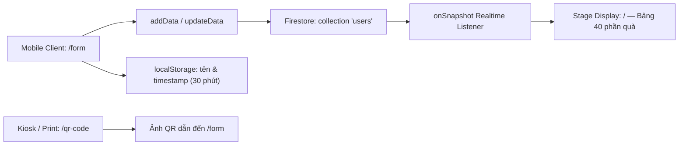

# Technical Guide · BCS Year End Party

[Tổng quan dự án và năng lực thể hiện](README.md)

Tài liệu dành cho lập trình viên và agents: phạm vi triển khai, công nghệ, kiến trúc, cấu hình và kiểm tra. Các đường dẫn tương đối bắt đầu từ thư mục gốc repository.

[Phạm vi](#scope) · [Skills & Tech Stack](#stack) · [Kiến trúc & API](#architecture) · [Cài đặt](#setup) · [Điểm kỹ thuật](#highlights) · [Hướng cải thiện](#roadmap) · [Tham khảo](#references) · [Giấy phép](#license)

<a id="scope"></a>

## 📍 Implementation Scope (Phạm vi triển khai)

Ứng dụng được xây dựng dưới dạng Single Page Application (SPA) với React và Firebase Cloud Firestore, phục vụ sự kiện tiệc tất niên của BCS. Hệ thống gồm ba màn hình chính: màn hình hiển thị quà sân khấu, cổng ghi danh khách mời và trang chứa mã QR.

| Thành phần | Trách nhiệm | Trạng thái / Giới hạn |
| :--- | :--- | :--- |
| **Bảng quà sân khấu (`/`)** | Hiển thị 40 phần quà và lắng nghe Firestore `onSnapshot` để cập nhật tên người nhận thời gian thực | Đã có · Tự động đồng bộ không cần reload trang |
| **Ghi danh di động (`/form`)** | Nhập tên khách mời, kiểm tra trùng lặp và gán ngẫu nhiên một `imageId` chưa dùng | Đã có · Lưu phiên tạm 30 phút vào `localStorage` |
| **Trang QR Code (`/qr-code`)** | Hiển thị mã QR để khách mời quét và mở trang ghi danh trực tiếp trên điện thoại | Đã có · Ảnh QR gắn sẵn |
| **Firebase Cloud Firestore** | Lưu trữ collection `users` và broadcast sự kiện thời gian thực tới tất cả client | Đã có · Kết nối project Firebase `bcs-yep` |
| **GitHub Pages CI/CD** | Tự động đóng gói ứng dụng React và deploy lên GitHub Pages với cơ chế SPA fallback | Đã có · Workflow `.github/workflows/deploy.yml` |

Ứng dụng không cần backend server riêng vì tận dụng trực tiếp tính năng thời gian thực của Cloud Firestore. Quản lý trạng thái client dựa trên React hooks và `localStorage` cho phiên ghi danh.

---

<a id="stack"></a>

## 🛠 Skills & Tech Stack (Kỹ năng & Công nghệ)

| Tầng / Nhóm | Công nghệ và phiên bản | Vai trò / Lý do sử dụng |
| :--- | :--- | :--- |
| **Frontend Framework** | React 16.12.0, ReactDOM 16.12.0 | Nền tảng xây dựng component và quản trị state giao diện |
| **Routing** | React Router DOM 5.1.2 | Định tuyến SPA giữa 3 màn hình (`/`, `/form`, `/qr-code`) với `basename` |
| **Backend & Realtime DB** | Firebase 11.1.0 (Cloud Firestore) | Cơ sở dữ liệu thời gian thực không máy chủ, đồng bộ qua `onSnapshot` |
| **Styling** | Tailwind CSS CDN, CSS thuần, Google Fonts Pacifico | Thiết kế giao diện mang không khí lễ hội Tết và đáp ứng tốt trên di động |
| **Build & Tooling** | Create React App 3 (`react-scripts` 3.0.1) | Môi trường đóng gói webpack, tối ưu hóa bundle tĩnh |
| **CI / Hosting** | GitHub Actions, GitHub Pages | Tự động hóa quy trình build và deploy static site lên GitHub Pages |

- **Kỹ năng kỹ thuật thể hiện:** Lập trình ứng dụng thời gian thực với Firestore listener; quản trị vòng đời component và hủy subscription đúng cách; cấu hình định tuyến SPA trên GitHub Pages với `404.html` fallback.
- **Nguồn cấu hình:** [package.json](package.json), [src/db/firebaseConfig.js](src/db/firebaseConfig.js).

---

<a id="architecture"></a>

## 🏗 System Architecture & API Design (Kiến trúc & Thiết kế API)

### System Architecture



### Repository Structure

```text
BCS-YEP-2024/
├── .github/
│   └── workflows/
│       └── deploy.yml          # GitHub Actions workflow deploy GitHub Pages
├── build/                      # Bản build production (tự động tạo ra)
├── public/
│   ├── images/                 # 40 hình ảnh phần quà sự kiện (.png)
│   ├── BCS-Logo.ico            # Favicon
│   ├── index.html              # HTML template với Tailwind CDN & font Pacifico
│   └── manifest.json
├── src/
│   ├── components/
│   │   ├── FormPage.js         # Giao diện ghi danh / cập nhật tên
│   │   ├── HomePage.js         # Bảng 40 phần quà đồng bộ thời gian thực
│   │   ├── Layout.js           # Khung layout nền sự kiện dùng chung
│   │   ├── Loading.js          # Spinner hiển thị khi ghi danh
│   │   └── QRCodePage.js       # Trang hiển thị mã QR
│   ├── db/
│   │   ├── actions.js          # Các thao tác Firestore: getData, addData, updateData
│   │   └── firebaseConfig.js   # Cấu hình kết nối Firebase app
│   ├── storage-actions/
│   │   └── index.js            # Quản lý localStorage phiên ghi danh (30 phút)
│   ├── constant.js             # Danh sách tên 40 ảnh quà tặng
│   ├── App.js                  # Khởi tạo React Router với basename
│   └── index.js                # Entry point ứng dụng React
└── package.json                # Dependencies, homepage và scripts
```

### API / Routes / Protocols

| Route / Hàm | Loại giao tiếp | Contract / Chức năng |
| :--- | :--- | :--- |
| `/` | Client Route | Màn hình sân khấu hiển thị 40 phần quà và cập nhật tên người nhận tức thì |
| `/form` | Client Route | Cổng ghi danh trên di động; cho phép nhập tên hoặc cập nhật tên đã ghi danh |
| `/qr-code` | Client Route | Trang hiển thị ảnh mã QR để khách quét và chuyển hướng đến trang `/form` |
| `getData(callback)` | Firestore Listener | Đăng ký `onSnapshot` lắng nghe collection `users`; trả về hàm `unsubscribe` |
| `addData(name)` | Firestore Mutation | Kiểm tra tên trùng, chọn ngẫu nhiên `imageId` còn trống và lưu document mới |
| `updateData(oldName, name)` | Firestore Mutation | Tìm document có tên cũ và cập nhật sang tên mới trong cùng phiên |

---

<a id="setup"></a>

## 🚀 Getting Started (Cài đặt & Chạy thử)

### Prerequisites

- **Runtime:** Node.js (khuyến nghị phiên bản 16 hoặc 18) và npm.
- **Tài khoản / Dự án Firebase:** Project Firebase `bcs-yep` với Cloud Firestore đã được kích hoạt.
- **Internet:** Cần kết nối mạng để tải Tailwind CDN, Google Fonts và kết nối Firestore listener.

### Installation

**Thư mục thực hiện:** Thư mục gốc `BCS-YEP-2024`.

```bash
git clone https://github.com/nhttoan0809/BCS-YEP-2024.git
cd BCS-YEP-2024
npm install
```

_(Nếu dùng Bun: `bun install` để cài đặt nhanh hơn)._

### Configuration

Cấu hình Firebase được quản lý tại [src/db/firebaseConfig.js](src/db/firebaseConfig.js).

| Biến / File | Ý nghĩa | Bắt buộc / Giá trị mẫu |
| :--- | :--- | :--- |
| `firebaseConfig.projectId` | Định danh dự án Firebase | Bắt buộc (`bcs-yep`) |
| `firebaseConfig.apiKey` | Khóa API công khai của Firebase | Bắt buộc |
| `package.json -> homepage` | Base path triển khai trên GitHub Pages | `https://nhttoan0809.github.io/BCS-YEP-2024` |

### Development & Build

```bash
# Chạy local dev server (trên macOS/Linux)
NODE_OPTIONS=--openssl-legacy-provider npm start

# Đóng gói bản production và tạo 404.html fallback
NODE_OPTIONS=--openssl-legacy-provider npm run build
```

- **URL cục bộ:** Mở `http://localhost:3000/` để xem bảng quà sân khấu, mở `http://localhost:3000/form` ở một tab khác để thử nghiệm ghi danh và quan sát tên hiển thị cập nhật thời gian thực.

---

<a id="highlights"></a>

## 🔍 Implementation Highlights (Điểm kỹ thuật & Module)

### Module Map

| Module / Đường dẫn | Trách nhiệm | Điểm cần chú ý |
| :--- | :--- | :--- |
| `src/App.js` | Định tuyến SPA với React Router | Khai báo `basename={process.env.PUBLIC_URL}` để hoạt động đúng trên GitHub Pages subpath |
| `src/components/HomePage.js` | Màn hình hiển thị 40 ô quà tặng | Dùng `${process.env.PUBLIC_URL}/images/${image}.png` để nạp đúng ảnh quà tặng trên mọi môi trường |
| `src/components/FormPage.js` | Biểu mẫu nhập tên và nút hành động | Kiểm tra trùng tên, vô hiệu hóa nút khi đang gửi và chuyển hướng sau khi hoàn tất |
| `src/db/actions.js` | Giao tiếp Cloud Firestore | Xử lý transaction, listener `onSnapshot` kèm callback lỗi để tránh unhandled rejection |
| `src/storage-actions/index.js` | Quản trị phiên ghi danh local | Lưu tên người tham dự trong 30 phút để hỗ trợ sửa tên nếu cần |

### Technical Decisions & Limitations

- **Firestore Snapshot Listener:** Chọn Firestore làm tầng đồng bộ giúp loại bỏ sự cần thiết của một Node.js backend riêng, tiết kiệm tài nguyên vận hành và đảm bảo độ trễ cập nhật dưới 1 giây.
- **Cơ chế Base URL & SPA Fallback:** Khi deploy lên GitHub Pages với tên repo làm subpath, React Router cần `basename` chính xác và thư mục `build/` cần có `404.html` (bản sao của `index.html`) kèm file `.nojekyll` để ngăn Jekyll can thiệp.
- **Giới hạn triển khai:** Việc chọn quà ngẫu nhiên hiện đọc danh sách quà đã nhận rồi mới gán quà trống. Khi có hàng trăm người bấm ghi danh cùng một giây, có thể phát sinh trường hợp tranh chấp (contention).

### Verification

```bash
# Kiểm tra build production
NODE_OPTIONS=--openssl-legacy-provider npm run build

# Chạy test suite nếu có
npm test -- --watchAll=false --passWithNoTests
```

### Deployment & Operations

Dự án được cấu hình triển khai tự động qua **GitHub Actions**:

- **Workflow:** `.github/workflows/deploy.yml` tự động chạy khi có commit đẩy lên nhánh `main`.
- **Quy trình:** Setup Node.js 18 → `npm ci` → Build React application với cờ `--openssl-legacy-provider` → Tự động tạo `404.html` & `.nojekyll` → Đẩy artifact lên GitHub Pages.
- **URL công khai:**
  - Bảng chính: `https://nhttoan0809.github.io/BCS-YEP-2024/`
  - Ghi danh: `https://nhttoan0809.github.io/BCS-YEP-2024/form`
  - Mã QR: `https://nhttoan0809.github.io/BCS-YEP-2024/qr-code`

---

<a id="roadmap"></a>

## 📈 Learnings & Technical Roadmap (Bài học & Hướng cải thiện)

### Key Learnings

- **Đồng bộ thời gian thực không máy chủ:** Firestore `onSnapshot` kết hợp React hooks mang lại trải nghiệm tương tác trực tiếp ấn tượng cho các sự kiện nội bộ mà không tốn công dựng backend websocket riêng.
- **Bảo toàn SPA trên GitHub Pages:** Việc cấu hình `homepage`, `basename` cho Router và tạo file `404.html` là yếu tố then chốt giúp các ứng dụng React Router chạy ổn định trên GitHub Pages.

### Technical Roadmap

- [ ] Chuyển đổi cấu hình Firebase sang file `.env` để bảo mật thông tin dự án.
- [ ] Refactor thuật toán phân quà dùng Firestore Transaction trọn vẹn từ khâu đọc đến ghi để triệt tiêu race condition.
- [ ] Bổ sung hiệu ứng âm thanh và hoạt họa pháo hoa khi quà được mở trên màn hình lớn.

---

<a id="references"></a>

## 📚 References (Tài liệu liên quan)

- [Ảnh giao diện chính](BCS-YEP-Main.png), [ảnh biểu mẫu ghi danh](BCS-YEP-Form.png), [ảnh mã QR](BCS-YEP-QR.png).
- [Cấu hình Firebase](src/db/firebaseConfig.js), [Thao tác dữ liệu](src/db/actions.js).

---

<a id="license"></a>

## 📄 License

Dự án hiện chưa có tệp `LICENSE` chính thức ở thư mục gốc repo. Mã nguồn được tác giả xây dựng phục vụ sự kiện nội bộ của BCS.
