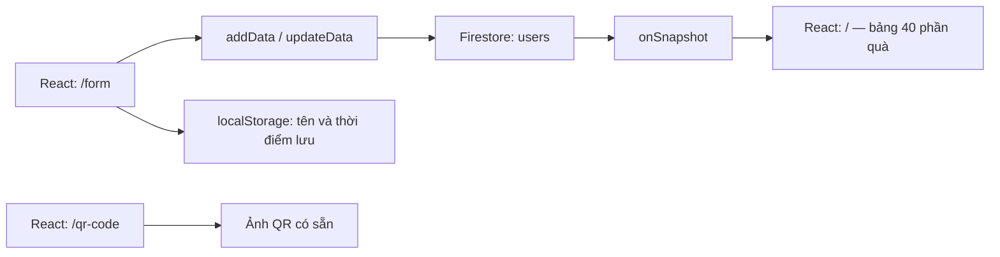

# Technical Guide · BCS Year End Party

[Tổng quan dự án và năng lực thể hiện](README.md)

Tài liệu dành cho lập trình viên và agents: phạm vi triển khai, công nghệ, kiến trúc, cấu hình và cách kiểm tra. Các đường dẫn tương đối bắt đầu từ thư mục gốc repository.

[Phạm vi](#scope) · [Skills & Tech Stack](#stack) · [Kiến trúc & API](#architecture) · [Cài đặt](#setup) · [Điểm kỹ thuật](#highlights) · [Hướng cải thiện](#roadmap) · [Tham khảo](#references) · [Giấy phép](#license)

<a id="scope"></a>

## 📍 Implementation Scope (Phạm vi triển khai)

SPA có ba route: bảng quà, ghi danh và trang QR. Danh sách quà gồm 40 `imageId`. Khi ghi danh, client đọc collection `users`, kiểm tra trùng tên, chọn ngẫu nhiên ảnh quà chưa được dùng và ghi `{ name, imageId }`.

`onSnapshot` cập nhật bảng kết quả; component hủy subscription khi unmount. Tên và thời điểm ghi danh được lưu bằng `localStorage`, hết hiệu lực sau 30 phút. Đây không phải xác thực người dùng. Trang QR dùng ảnh có sẵn; cần thay ảnh khi đổi URL sự kiện.

Tên repo có mốc `2024`, trong khi tiêu đề HTML ghi `2025`. Repo chưa ghi nhận URL demo cố định. Điểm cần xử lý trước khi dùng lại: tính duy nhất khi ghi đồng thời, lỗi mạng/ghi dữ liệu và trường hợp hết quà.

---

<a id="stack"></a>

## 🛠 Skills & Tech Stack (Kỹ năng & Công nghệ)

| Tầng kiến trúc         | Công nghệ chính                              | Lý do phù hợp với triển khai hiện tại                                   |
| :--------------------- | :------------------------------------------- | :---------------------------------------------------------------------- |
| **Frontend**           | React 16.12, JavaScript, React Router 5      | Tách ba màn hình và chuyển trang trong một SPA                          |
| **Styling**            | CSS, Tailwind qua CDN, Google Fonts Pacifico | Dựng giao diện mang không khí Tết; CDN được khai báo trong HTML         |
| **Backend / Database** | Firebase 11, Cloud Firestore                 | Lưu danh sách và nhận thay đổi qua `onSnapshot`, không cần server riêng |
| **Client State**       | React hooks, `localStorage`                  | Quản lý biểu mẫu và tên đã ghi danh                                     |
| **Build & Tools**      | Create React App, `react-scripts` 3, npm     | Script development/build/test đã khai báo; có `package-lock.json`       |

Firebase Auth được khởi tạo trong cấu hình nhưng chưa có luồng đăng nhập sử dụng nó. Repo không chứa Firestore Rules hoặc pipeline CI/CD để xác minh chính sách truy cập hay việc triển khai tự động.

---

<a id="architecture"></a>

## 🏗 System Architecture & API Design (Kiến trúc & Thiết kế API)



| Route / Hàm                                        | Chức năng                                                  |
| :------------------------------------------------- | :--------------------------------------------------------- |
| `/`                                                | Hiển thị quà và tên người nhận                             |
| `/form`                                            | Ghi danh hoặc cập nhật tên                                 |
| `/qr-code`                                         | Hiển thị QR; cần thay ảnh QR nếu đổi địa chỉ sự kiện       |
| `getData(callback)`                                | Nhận danh sách qua Firestore listener; trả hàm unsubscribe |
| `addData(name)` / `updateData(previousName, name)` | Gán quà khi ghi danh / đổi tên đã lưu                      |

---

<a id="setup"></a>

## 🚀 Getting Started (Cài đặt & Chạy thử)

### Điều kiện tiên quyết (Prerequisites)

- Node.js và npm. Repo chưa khai báo phiên bản Node chuẩn; CRA 3 có thể cần tùy chọn OpenSSL legacy trên Node mới.
- Firebase project của bạn, bật Cloud Firestore và cấu hình quyền đọc/ghi phù hợp.
- Internet để tải Tailwind CDN và font của giao diện.

### Các bước cài đặt (Quick Steps)

1. **Clone repository và cài dependencies:**

   ```bash
   git clone https://github.com/nhttoan0809/BCS-YEP-2024.git
   cd BCS-YEP-2024
   npm ci
   ```

2. **Cấu hình Firebase:** Sửa `firebaseConfig` trong [src/db/firebaseConfig.js](src/db/firebaseConfig.js) bằng cấu hình project của bạn. Repo chưa có `.env.example` hoặc logic đọc cấu hình từ `.env`. Dữ liệu dùng collection `users`; 40 ảnh quà nằm trong [public/images](public/images).

3. **Chạy trên macOS/Linux:** `npm start` hiện dùng cú pháp `set` của Windows. Có thể gọi trực tiếp CRA trên macOS/Linux:

   ```bash
   NODE_OPTIONS=--openssl-legacy-provider npm exec -- react-scripts start
   ```

   Trên Windows Command Prompt, dùng `npm start` theo script sẵn có.

4. **Build và kiểm tra:**

   ```bash
   NODE_OPTIONS=--openssl-legacy-provider npm run build
   npm test -- --watchAll=false --passWithNoTests
   ```

   Repo chưa có file kiểm thử ứng dụng; `--passWithNoTests` cho phép lệnh kết thúc khi không tìm thấy test. Bản build nằm trong `build/`. Khi deploy SPA cần fallback về `index.html` cho `/form` và `/qr-code`.

5. **Truy cập:** Mở `http://localhost:3000`, ghi danh tại `/form` rồi quan sát bảng quà ở cửa sổ khác.

---

<a id="highlights"></a>

## 🔍 Implementation Highlights (Điểm kỹ thuật & Module)

- **Các module triển khai:**
  - [src/components](src/components): giao diện danh sách quà, biểu mẫu, QR và layout dùng chung.
  - [src/db/actions.js](src/db/actions.js): listener, kiểm tra tên, chọn quà và cập nhật Firestore.
  - [src/storage-actions/index.js](src/storage-actions/index.js): lưu tên kèm thời hạn 30 phút.
- **Thử thách kỹ thuật (Key Technical Challenge):** Đồng bộ bảng kết quả và hạn chế trùng quà khi nhiều người ghi danh. Mã có `runTransaction`, nhưng truy vấn danh sách dùng `getDocs` ngoài tập đọc của transaction. Chưa đủ cơ sở khẳng định việc gán quà duy nhất được bảo đảm khi có ghi đồng thời.

---

<a id="roadmap"></a>

## 📈 Learnings & Technical Roadmap (Bài học & Hướng cải thiện)

### Bài học rút ra (Key Learnings)

- Kết hợp Firestore listener với React hooks và dọn subscription đúng vòng đời.
- Phân biệt trạng thái tiện ích trong `localStorage` với danh tính được xác thực.
- Một transaction bao quanh thao tác ghi chưa đủ bảo đảm tính duy nhất nếu dữ liệu quyết định được đọc bên ngoài transaction.

### Kế hoạch nâng cấp (Roadmap)

Các mục dưới đây là hướng cải thiện đề xuất từ mã nguồn hiện tại.

- [ ] Quản lý tồn kho quà bằng các document được đọc/ghi trong transaction và kiểm thử ghi đồng thời.
- [ ] Xử lý hết quà, mất mạng hoặc ghi Firestore thất bại trước khi báo ghi danh thành công.
- [ ] Bổ sung Firestore Rules, xác thực phù hợp và cấu hình môi trường tách khỏi mã nguồn.
- [ ] Chuẩn hóa script đa nền tảng và thêm test cho ghi danh, đổi tên, hết quà.

---

<a id="references"></a>

## 📚 References (Tài liệu liên quan)

- [Ảnh biểu mẫu](BCS-YEP-Form.png), [ảnh QR](BCS-YEP-QR.png), [bảng quà](BCS-YEP-Main.png).
- [Cấu hình Firebase](src/db/firebaseConfig.js), [danh sách quà](src/constant.js), [API dữ liệu nội bộ](src/db/actions.js).

---

<a id="license"></a>

## 📄 License

Repo chưa có file `LICENSE` hoặc khai báo giấy phép trong `package.json`. Chưa xác định giấy phép phân phối; không mặc định áp dụng MIT.
